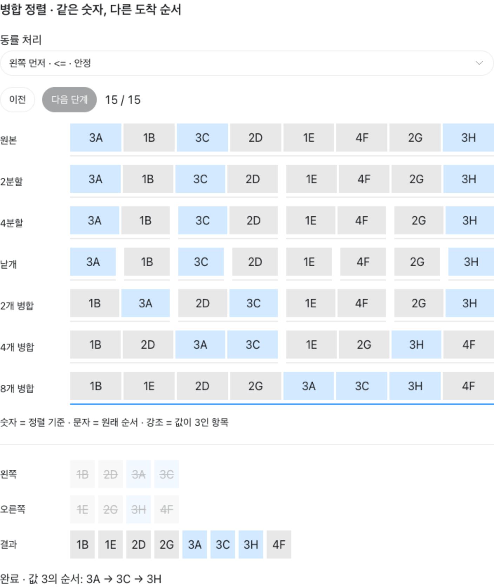
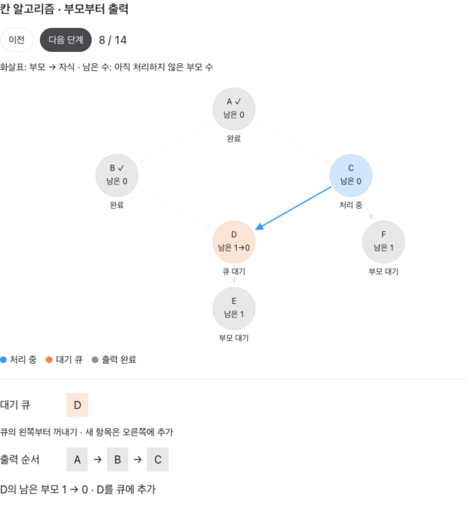
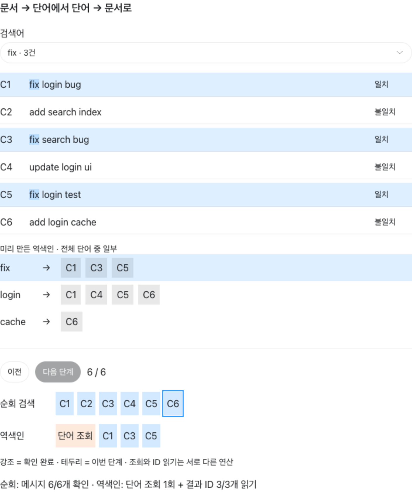

# 대화와 그림으로 이해하는 Mini Git 알고리즘

이 문서는 정렬·역색인·BFS·DFS·칸 알고리즘을 질문과 답변으로 풀어 쓴 학습 자료입니다. 2026년 10월 22일 대화 내용과 현재 프로젝트 코드를 기준으로 정리했습니다. 예시에 등장하는 A, B, C와 C1, C2 등은 설명용 커밋 이름입니다.

## 읽는 방법과 시각화

본문의 그림은 Markdown 미리보기에서 바로 볼 수 있습니다. 아래 HTML 파일을 브라우저로 열면 대화에서처럼 버튼을 누르며 단계를 확인할 수 있습니다. Markdown 자체에서는 JavaScript가 실행되지 않으므로 두 형태를 함께 제공합니다.

| 주제 | 직접 조작하는 시각화 | 확인할 부분 |
| --- | --- | --- |
| 병합 정렬 | [병합 정렬 열기](visualizations/merge-sort.html) | 분할·병합, 동률일 때 왼쪽과 오른쪽 선택의 차이 |
| 역색인 | [역색인 열기](visualizations/inverted-index.html) | 전체 메시지 검사와 결과 ID 읽기의 차이 |
| 칸 알고리즘 | [칸 알고리즘 열기](visualizations/kahn-commits.html) | 남은 부모 수, 대기 큐, 출력 순서 |

Markdown 뷰어가 HTML을 코드로만 보여 주면 해당 파일을 Chrome이나 Safari 같은 브라우저로 여세요. 다른 곳으로 옮길 때는 이 문서와 `images`, `visualizations` 폴더를 함께 옮기면 연결이 유지됩니다.

## 1. 각 알고리즘은 언제 사용하나요?

먼저 명령과 알고리즘을 연결해 두면 뒤의 설명을 이해하기 쉽습니다.

| 명령 | 사용하는 방법 | 해결하는 문제 |
| --- | --- | --- |
| `LOG` | 칸 알고리즘으로 위상 정렬 | 부모가 자식보다 먼저 나오도록 전체 커밋 나열 |
| `LOG --sort-by=date` | 병합 정렬 | 전체 커밋을 시각이 이른 순서로 나열 |
| `LOG --sort-by=author` | 병합 정렬 | 전체 커밋을 작성자 이름순으로 나열 |
| `SEARCH login` | 단어 역색인 | 메시지에 해당 단어가 있는 커밋 선택 |
| `SEARCH --author=Alice` | 작성자 역색인 | 해당 작성자의 커밋 선택 |
| `PATH A B` | BFS | 부모·자식 연결을 양방향으로 이동하는 최단 경로 찾기 |
| `ANCESTORS A` | DFS | 부모 방향으로 따라가며 모든 조상 찾기 |

**정렬은 “어떤 순서로 보여 줄까?”, 검색은 “어떤 커밋을 골라낼까?”, 그래프 탐색은 “어떻게 연결되어 있을까?”를 다룹니다.**

현재 검색 결과에는 병합 정렬을 추가로 적용하지 않습니다. 또한 `LOG`의 기본 위상 순서와 옵션을 붙인 날짜·작성자 순서는 별개의 정렬입니다. 옵션 정렬은 부모 우선 순서를 따로 보장하지 않습니다.

## 2. 병합 정렬은 무엇을 하는 건가요?

**배열을 반씩 나눈 뒤, 작은 값부터 골라 합치는 방법입니다.**



[병합 정렬을 단계별로 보기](visualizations/merge-sort.html)

### Q. 작은 값을 맨 앞에, 큰 값을 맨 뒤에 고정하는 건가요?

지금 구현은 오름차순이므로 최종 결과가 작은 값부터 큰 값까지 나열됩니다. 병합할 때는 **이미 정렬된 두 묶음의 맨 앞만 비교하고, 더 작은 값을 결과의 다음 칸에 붙입니다.**

예를 들어 `[2, 5]`와 `[1, 4]`를 합치면 다음과 같습니다.

```text
왼쪽       오른쪽      비교·선택             결과
[2, 5]     [1, 4]     2와 1 → 1 선택       [1]
[2, 5]     [4]        2와 4 → 2 선택       [1, 2]
[5]        [4]        5와 4 → 4 선택       [1, 2, 4]
[5]        []         남은 5 붙이기         [1, 2, 4, 5]
```

결과를 앞에서부터 한 칸씩 채웁니다. 작은 값부터 꺼내다 보면 큰 값이 자연스럽게 뒤에 남습니다. 내림차순으로 만들려면 더 큰 값을 먼저 꺼내도록 비교 조건을 바꿉니다.

### Q. 직접 구현한다면 무엇부터 작성하나요?

다음 세 동작을 연결합니다. 현재 실제 구현은 [algorithms.py의 merge_sort](../algorithms.py)에 있습니다.

1. 항목이 0개나 1개면 그대로 반환합니다.
2. 반으로 나눈 양쪽에 같은 함수를 재귀 호출합니다.
3. 정렬된 양쪽을 비교하며 병합하고, 한쪽이 비면 다른 쪽의 나머지를 붙입니다.

```text
[4, 2, 3, 1]
       ↓ 반씩 분할
[4, 2]     [3, 1]
       ↓ 다시 분할
[4] [2]    [3] [1]
       ↓ 작은 값부터 병합
[2, 4]     [1, 3]
       ↓ 다시 병합
[1, 2, 3, 4]
```

## 3. “작은 값”은 커밋 해시를 말하나요?

**현재 프로젝트에서는 선택한 정렬 기준의 값입니다.**

| 정렬 옵션 | 꺼내 비교하는 값 | 앞에 오는 커밋 |
| --- | --- | --- |
| `date` | `timestamp` | 시각이 더 이른 커밋 |
| `author` | `author` | 작성자 이름이 Python 문자열 비교 순서에서 앞서는 커밋 |

```text
커밋 A: hash=f9a…, 시각=09:00
커밋 B: hash=12b…, 시각=10:00

날짜 비교: 09:00 < 10:00
출력 순서: A → B
```

위 해시는 비교 기준과 식별자를 구분하기 위한 설명용 값입니다. 현재 프로그램의 실제 식별자는 `00000001`부터 증가하는 16진수 문자열입니다.

실제 병합 코드에서 다음 조건의 `key(...)`가 커밋에서 비교할 값만 꺼냅니다.

```python
if key(left[left_index]) <= key(right[right_index]):
```

날짜 정렬에서는 “왼쪽 커밋의 시각이 오른쪽 커밋의 시각보다 이르거나 같은가?”라는 뜻입니다. 해시는 커밋을 식별하는 ID로 사용하며, 현재 병합 정렬의 비교 기준으로 사용하지 않습니다.

### Q. date나 author로 검색할 때도 병합 정렬을 쓰나요?

현재 `date`와 `author`는 `LOG --sort-by=...`에서 정렬 기준으로 사용합니다. 작성자 검색은 별도의 `SEARCH --author=...`이며 역색인을 사용합니다. 날짜로 걸러 내는 검색 명령은 현재 없습니다.

```text
LOG --sort-by=author
→ 전체 커밋을 작성자 이름순으로 나열

SEARCH --author=Alice
→ Alice가 작성한 커밋만 골라 조회
```

## 4. 안정 정렬은 무슨 뜻인가요?

**정렬 기준의 값이 같은 항목끼리 원래 상대 순서를 유지하는 정렬입니다.**

`3A`, `3C`, `3H`는 정렬 기준 숫자는 같지만 서로 다른 항목입니다. 문자는 원래 순서를 표시합니다.

```text
원래 등장 순서: 3A → 3C → 3H

안정 정렬 결과: … 3A → 3C → 3H …
순서가 바뀐 결과: … 3H → 3C → 3A …
```

현재 병합 정렬은 `<=`로 비교합니다. 값이 같을 때 왼쪽 항목을 먼저 넣으므로 원래 상대 순서를 유지합니다. 이를 `<`로 바꿔 동률이면 오른쪽을 먼저 넣으면 안정성이 깨질 수 있습니다.

시각화의 **동률 처리** 선택을 바꿔 확인해 보세요. 작성자가 같은 커밋 여러 개를 작성자 기준으로 정렬한다면, 안정 정렬은 그 커밋들의 기존 생성 순서를 유지합니다.

## 5. 정렬의 평균·최악 시간복잡도는 어떻게 설명하나요?

시간복잡도는 실행 시간을 초로 표시하는 것이 아니라, **입력 크기가 늘어날 때 작업량이 얼마나 늘어나는지** 나타냅니다.

- **평균:** 가정한 입력 분포에서 평균적으로 필요한 작업량입니다.
- **최악:** 같은 크기의 입력 중 가장 많은 작업이 필요한 경우입니다.
- **N:** 정렬할 항목 수입니다. 아래 표는 비교 한 번의 비용이 일정하다고 가정합니다.

| 정렬 알고리즘 | 평균 | 최악 | 일반적인 구현의 안정성 |
| --- | --- | --- | --- |
| 버블 정렬 | O(N²) | O(N²) | 안정 |
| 삽입 정렬 | O(N²) | O(N²) | 안정 |
| 선택 정렬 | O(N²) | O(N²) | 불안정 |
| 병합 정렬 | O(N log N) | O(N log N) | 안정 |
| 퀵 정렬 | O(N log N) | O(N²) | 불안정 |
| 힙 정렬 | O(N log N) | O(N log N) | 불안정 |

안정성은 구현에 따라 달라질 수 있습니다. 버블 정렬은 동률을 교환하지 않고, 삽입 정렬은 같은 값의 상대 순서를 유지하며 이동하는 일반적인 구현을 기준으로 합니다. 병합 정렬은 동률이면 왼쪽을 먼저 선택하는 구현을 기준으로 합니다.

### 병합 정렬이 O(N log N)인 이유

```text
8개 → 4개 → 2개 → 1개: 병합 층수 3
16개 → 8개 → 4개 → 2개 → 1개: 병합 층수 4

각 병합 층에서 전체 N개 항목 처리
× 병합 층수 약 log₂N
= O(N log N)
```

입력 순서가 달라도 반으로 나누는 구조는 유지됩니다. 따라서 평균과 최악 모두 O(N log N)입니다. 현재 구현의 추가 공간은 최대 동시 사용량 기준 O(N)입니다.

## 6. BFS와 DFS도 커밋에 사용하나요?

네. **커밋을 점으로, 부모·자식 관계를 연결선으로 보고 탐색합니다.** 이런 구조를 그래프라고 부릅니다.

```text
A → B → C
    └→ D → E
```

화살표는 부모에서 자식 방향입니다.

### BFS: 두 커밋 사이 최단 경로

BFS는 가까운 곳부터 한 단계씩 넓혀 가며 찾는 방법입니다. `PATH C E`는 연결선을 가장 적게 지나는 경로를 찾습니다. 현재 PATH에서는 부모·자식 방향 모두로 이동할 수 있습니다.

```text
C → B → D → E
```

현재 코드는 목표 커밋에서 시작하는 BFS로 각 커밋의 거리를 구한 뒤, 시작 커밋부터 거리가 줄어드는 방향으로 경로를 만듭니다. 위 출력은 최종 경로이며, BFS의 실제 방문 순서와는 구분합니다.

### DFS: 부모를 따라 모든 조상 찾기

DFS는 한쪽을 깊게 따라갔다가 돌아와 다른 쪽을 살피는 방법입니다. `ANCESTORS E`는 부모 방향으로 따라가며 모든 조상을 찾습니다.

```text
E에서 출발 → D → B → A
조상 결과: D, B, A
```

시작 커밋 E 자신은 조상에 포함하지 않습니다. 여러 부모가 있는 그래프에서는 다른 부모 쪽도 방문하며, 같은 조상은 중복해서 반환하지 않습니다.

인접 목록으로 구현한 BFS와 DFS의 탐색 비용은 보통 O(V + E)입니다. 여기서 V는 노드 수, E는 연결선 수입니다. 도달 가능한 일부만 탐색한다면 실제 방문한 노드와 살펴본 간선을 기준으로 볼 수 있습니다.

## 7. 칸 알고리즘을 쉬운 말로 설명하면?

**“내 앞에서 해야 할 일이 모두 끝난 것부터 처리하는 방법”입니다.** 커밋에서는 모든 부모를 먼저 보여 준 다음 자식을 보여 주는 순서를 만듭니다. 이렇게 연결 방향을 지키는 순서를 만드는 것을 위상 정렬이라고 합니다.



[칸 알고리즘을 단계별로 보기](visualizations/kahn-commits.html)

### 어려운 용어를 바꿔 읽기

| 용어 | 쉬운 표현 |
| --- | --- |
| 노드 | 커밋 하나 |
| 간선 | 부모와 자식을 연결하는 화살표 하나 |
| 진입 차수 | 처음에는 부모 수, 진행 중에는 아직 처리하지 않은 부모 수 |
| 큐 | 지금 처리할 수 있는 커밋들의 대기 줄 |
| 진입 차수 1 감소 | 기다리던 부모 하나의 처리가 끝남 |

정확히는 원래 그래프의 진입 차수 자체가 바뀌는 것이 아니라, **알고리즘에서 관리하는 남은 진입 차수**를 줄입니다. 처리된 간선을 지운 것처럼 생각하면 됩니다. 실제 코드에서 원본 부모·자식 연결을 삭제하지는 않습니다.

### 부모가 둘인 D를 생각해 보기

```text
A ─→ B ─┐
│       ├─→ D ─→ E
└─→ C ─┘
     └────────→ F
```

시각화는 여러 부모를 기다리는 원리를 보여 주려고 병합 커밋 D를 넣은 학습용 예시입니다. 현재 CLI의 `COMMIT` 명령은 부모가 최대 하나인 커밋을 생성합니다. 위상 정렬 함수 자체는 여러 부모를 가진 그래프도 처리할 수 있습니다.

1. **A는 부모가 없으므로 대기 줄에 넣습니다.**
2. A를 꺼내 출력합니다. A를 기다리던 B와 C의 남은 부모 수가 0이 되어 대기 줄에 들어갑니다.
3. B를 출력합니다. D의 남은 부모 수는 `2 → 1`입니다. 아직 C를 기다려야 합니다.
4. C를 출력합니다. D는 `1 → 0`이 되어 대기 줄에 들어갑니다. F도 부모 C의 처리가 끝났으므로 들어갑니다.
5. D를 출력하면 E가 대기 줄에 들어갑니다. 먼저 기다리던 F를 처리한 뒤 E를 처리합니다.

각 커밋의 자식까지 처리한 직후의 상태를 정리하면 다음과 같습니다. 대기 줄의 왼쪽이 앞입니다.

| 처리한 커밋 | 대기 줄 | 지금까지의 출력 |
| --- | --- | --- |
| 시작 전 | A | 없음 |
| A | B, C | A |
| B | C | A, B |
| C | D, F | A, B, C |
| D | F, E | A, B, C, D |
| F | E | A, B, C, D, F |
| E | 비어 있음 | A, B, C, D, F, E |

### Q. 꼭 이 순서 하나만 정답인가요?

아닙니다. **모든 부모가 자식보다 먼저 나온다면 가능한 순서는 여러 개일 수 있습니다.** 준비된 커밋이 여러 개일 때 무엇을 먼저 선택하는지에 따라 결과가 달라집니다. 현재 구현은 큐에 먼저 들어온 커밋부터 꺼냅니다.

### Q. 대기 줄이 비었는데 남은 커밋이 있다면요?

올바르게 구성된 그래프에서 전체 커밋을 처리하지 못했다면 순환이 있다는 뜻입니다.

```text
A → B → A

A: B가 먼저 끝나야 함
B: A가 먼저 끝나야 함
→ 둘 다 기다리기만 하므로 시작할 수 없음
```

실제 코드는 출력한 커밋 수와 전체 커밋 수가 다르면 `Cycle detected` 오류를 냅니다.

칸 알고리즘의 시간복잡도는 O(V + E)입니다. 각 커밋을 한 번씩 꺼내고, 각 부모·자식 연결을 한 번씩 처리하기 때문입니다. BFS와 마찬가지로 큐를 사용하지만, 칸 알고리즘의 큐 진입 조건은 **남은 부모 수가 0이 되는 것**입니다.

## 8. 역색인은 왜 순회 검색보다 빠른가요?

**단어가 들어 있는 커밋 목록을 미리 만들어 두기 때문입니다.** 책 뒤쪽의 찾아보기에서 단어를 찾고 해당 쪽으로 이동하는 것과 비슷합니다.



[역색인 검색을 단계별로 보기](visualizations/inverted-index.html)

### 방향을 뒤집어 저장하기

```text
원본 메시지: 커밋 → 단어

C1 → fix login bug
C2 → add search index
C3 → fix search bug
C4 → update login ui
C5 → fix login test
C6 → add login cache

역색인: 단어 → 커밋 ID 목록

fix   → C1, C3, C5
login → C1, C4, C5, C6
cache → C6
```

단어 옆에 저장한 커밋 ID 목록을 **포스팅 목록**이라고 합니다.

순회 검색은 검색할 때마다 메시지들을 검사합니다. 역색인은 검색어로 목록을 바로 찾고, 해당 ID의 커밋을 꺼냅니다.

### 현재 코드의 등록 방식

```python
for word in set(commit.message.lower().split()):
    self.keywords.setdefault(word, []).append(commit.hash)
```

소문자로 바꾸고 공백 기준으로 단어를 나눕니다. `set()`은 같은 메시지에 같은 단어가 반복돼도 해당 커밋 ID가 한 번만 등록되게 합니다.

단어 전체를 비교하므로 `login`으로 `LOGIN`은 찾지만 `log`로 `login`을 찾지는 않습니다. 구두점은 제거하지 않으므로 `login,`도 다른 단어입니다. 작성자 검색은 작성자 전체 이름을 대소문자까지 일치시켜 찾습니다.

### 여러 단어를 입력하면?

현재 코드는 AND 검색을 사용합니다. 두 단어 모두 포함된 커밋을 찾으려면 목록의 교집합을 구합니다.

```text
fix   → C1, C3, C5
login → C1, C4, C5, C6

SEARCH "fix login"
→ 공통 ID: C1, C5
```

## 9. 역색인은 시간복잡도를 분석하기 어렵나요?

**분석할 수 있습니다. 다만 어떤 단계인지, 결과가 몇 개인지 구분해야 합니다.** 실행 시간을 재는 것과 시간복잡도를 분석하는 것도 구분합니다. 한 번 측정한 초 단위 값만으로 O(N)인지 O(1)인지 판정할 수는 없습니다.

### 분석에 사용하는 기호

- **N:** 커밋 수
- **T:** 모든 메시지의 총 텍스트 길이
- **L:** 평균 메시지 길이. 따라서 T = N × L
- **k:** 검색 결과 커밋 수

다음 설명은 딕셔너리·집합의 평균적인 해시 성능을 가정합니다. 단어 검색 비용을 비교할 때는 검색어 길이와 ID 처리 비용을 일정하게 봅니다. 생성 비용은 전체 텍스트를 읽고 단어를 해시하는 비용까지 T에 포함해 봅니다.

| 작업 | 시간복잡도 | 이유 |
| --- | --- | --- |
| 역색인 만들기 | 평균 O(T) | 전체 텍스트를 읽고 단어별 ID 등록 |
| 매번 텍스트를 읽는 순회 검색 | O(T), 즉 O(NL) | 모든 메시지 검사 |
| 역색인에서 한 단어의 목록 위치 찾기 | 평균 O(1) | 딕셔너리 조회 |
| 결과 ID k개 읽기·반환 | O(k) | 결과 개수만큼 처리 |
| 준비된 역색인에서 한 단어의 결과 전체 반환 | 평균 O(1 + k) | 단어 조회와 결과 처리의 합 |

메시지 길이가 일정하다고 가정하면 순회 검색은 O(N)으로 단순화할 수 있습니다. 이미 단어 집합으로 전처리한 문서를 순회하는 경우처럼 비교 대상의 구조가 달라지면 그 전제에 맞춰 다시 분석해야 합니다.

### “조회 O(1)”과 “검색 전체 O(1)”은 다릅니다

```text
같은 커밋 100만 개에서도:

희귀한 단어 → 결과 3개
            → 단어 조회 + ID 3개 처리

흔한 단어   → 결과 90만 개
            → 단어 조회 + ID 90만 개 처리
```

현재 `search_keyword()`는 포스팅 목록을 집합으로 바꾸고 후보를 순회합니다. 따라서 한 단어라도 결과가 k개이면 평균 O(1 + k)입니다. `search_author()`도 ID 목록을 복사하므로 결과 수에 비례하는 비용이 듭니다.

검색어가 모든 커밋에 포함되면 k = N이므로 결과 ID를 읽는 데 O(N)이 필요합니다. 역색인을 저장할 추가 공간도 필요합니다. 처음 만드는 비용을 한 번 지불한 뒤 여러 번 검색할 때 이득을 얻는 구조입니다.

### 여러 단어 검색은 목록 길이도 따져야 합니다

현재 코드는 각 포스팅 목록을 집합으로 바꾸고, 가장 짧은 목록의 ID가 모든 집합에 있는지 검사합니다.

- 중복을 제거한 검색 단어 수: **m**
- 각 단어의 포스팅 목록 길이: **p₁, p₂, …, pₘ**
- 그중 가장 짧은 길이: **p_min**

검색어 전처리와 문자열 길이 비용을 별도로 두고, 평균적인 해시 성능을 가정하면 현재 검색 처리의 상한은 다음과 같이 볼 수 있습니다.

```text
목록 조회·관리       O(m)
모든 목록을 집합화    O(p₁ + p₂ + … + pₘ)
가장 짧은 목록 검사   O(m × p_min)

합계: O(m + Σpᵢ + m × p_min)
```

따라서 결과 k가 적더라도 중간 포스팅 목록이 크면 작업량이 커질 수 있습니다. 이는 현재 구현의 분석이며, 다른 교집합 구현에는 다른 분석이 필요합니다.

### 실제 시간을 비교할 때 기록할 것

역색인 생성 시간과 검색 시간을 따로 잽니다. 데이터 수뿐 아니라 전체 텍스트 길이, 검색어 수, 각 목록 길이, 결과 개수도 기록합니다. 같은 조건에서 여러 번 실행하고, 검색 함수만 잰 것인지 화면 출력까지 포함했는지도 표시해야 합니다.

이 문서의 수치는 원리를 설명하는 예시이며, 실제 실행 시간을 측정한 벤치마크 결과는 아닙니다.

## 10. 이해했는지 확인하기

1. `[2, 5]`와 `[1, 4]`를 오름차순으로 병합할 때 첫 번째로 꺼내는 값은 무엇인가요?
2. 날짜 기준 병합 정렬에서 커밋 해시는 비교 기준인가요?
3. 작성자별 정렬과 특정 작성자 검색은 각각 어떤 명령인가요?
4. 같은 값의 항목들이 원래 상대 순서를 유지한다는 말은 무슨 뜻인가요?
5. D의 부모가 B와 C일 때 B만 처리했다면 D를 큐에 넣을 수 있나요?
6. 칸 알고리즘에서 준비된 커밋이 둘이면 결과 순서는 하나뿐인가요?
7. `PATH`와 `ANCESTORS`는 각각 어떤 알고리즘을 사용하나요?
8. 역색인에서 단어 위치를 평균 O(1)에 찾는다면 결과 90만 개를 반환하는 것도 O(1)인가요?

### 정답과 해설

1. **1.** 두 묶음의 맨 앞인 2와 1을 비교해 1을 선택합니다.
2. **아닙니다.** `timestamp`를 비교하며 해시는 식별자로 사용합니다.
3. **`LOG --sort-by=author`와 `SEARCH --author=Alice`.** 전체의 순서를 정하는 것과 일부를 골라내는 것의 차이입니다.
4. **안정 정렬의 의미입니다.** 기준값이 같다면 원래 앞에 있던 항목이 정렬 후에도 앞에 있습니다.
5. **넣을 수 없습니다.** C가 아직 남아 있어 남은 부모 수가 1입니다.
6. **아닙니다.** 부모 우선 조건을 만족하는 여러 순서가 가능합니다.
7. **BFS와 DFS.** 최단 경로와 모든 조상 탐색에 각각 사용합니다.
8. **아닙니다.** 단어 위치를 찾는 비용에 결과 k개를 처리하는 O(k)가 더해집니다.

## 관련 자료와 코드

- [기초·핵심 지식](basic_knowledge.md): 프로젝트 전체의 배경 개념
- [학습 질문과 답변](study_qa.md): 명령별 세부 동작과 실습
- [코드 해설](code_translation.md): 실행 흐름과 줄별 설명
- [algorithms.py](../algorithms.py): 병합 정렬, 칸 알고리즘, DFS, BFS
- [index.py](../index.py): 역색인 등록과 검색
- [repository.py](../repository.py): 명령에서 알고리즘을 연결하는 부분

시각화의 그래프와 메시지는 학습용 고정 예시이며, 프로그램 실행 중의 저장소 데이터를 자동으로 읽어 표시하는 화면은 아닙니다.
